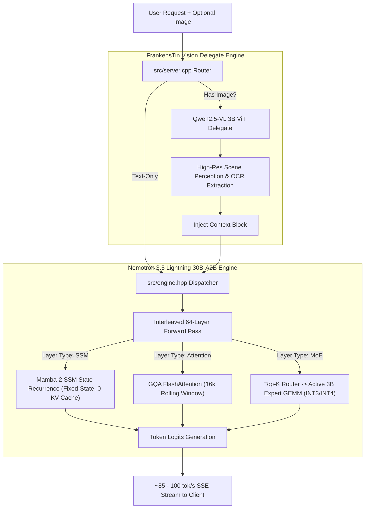

# Implementation Plan: Nemotron 3.5 Lightning + FrankensTin Vision (Phase 1: CUDA <16GB VRAM)

**Branch:** `models/nemotron3.5-lightning-vision`  
**Target Hardware (Phase 1):** NVIDIA GeForce RTX 5060 Ti 16GB (Blackwell `sm_120a`) | AMD Ryzen 7 5700X3D | Windows 11 WDDM 3.2  
**Target Hardware (Phase 2):** Apple Mac mini (M6, 24 GB Unified Memory, macOS 15+)  
**Memory Budget Ceiling:** Strict limit $\le 14,800\text{ MB}$ dedicated VRAM (zero WDDM paging thrashing)  
**Target Generation Speed:** $\ge 85 - 100\text{ tokens/second}$  

---

## 1. Executive Architecture Overview

Nemotron 3.5 Lightning (30B-A3B) combines **Mamba-2 State-Space Model (SSM) layers**, **Sparse MoE feed-forward layers** (activating only 3B parameters per token), and **select Multi-Head/Grouped-Query Attention layers**. 

By coupling this text/code engine with MinnieTheMoEcher's **FrankensTin Vision Delegate** ([`TinoBruno/frankenstin-vision-delegate`](https://huggingface.co/TinoBruno/frankenstin-vision-delegate)), we create a 100% in-VRAM multimodal engine that delivers:
1. **~90 tok/s generation throughput** on a consumer $399 card.
2. **~52.8% SWE-bench Verified coding capability**.
3. **Linear context scaling** via Mamba-2 SSM (avoiding quadratic KV-cache blowups).
4. **Decoupled high-resolution visual perception & OCR** via the 3.3 GB FrankensTin ViT delegate.



---

## 2. Memory Budget on RTX 5060 Ti 16GB

| Subsystem / Buffer | Quantization / Format | Memory Footprint | Residency Policy |
| :--- | :--- | :--- | :--- |
| **Dense Backbone** (Embeddings, SSM parameters, Attention, Routers, Norms) | FP8 / NVFP4 (`CUDA_R_8F_E4M3`) | **~1.85 GB** | 100% Pinned in VRAM |
| **MoE Sparse Experts** (30B Total, Top-K Routed) | Mixed INT3 / `IQ3_S` / INT4 | **~10.65 GB** | 100% Pinned in VRAM |
| **Mamba-2 SSM State Cache** | BF16 Recurrent Matrix ($d_{state} \times d_{head}$) | **~0.15 GB** | 100% Pinned in VRAM |
| **Attention KV Cache** (Selective GQA layers, 16k context) | FP8 Paged KV Cache | **~1.20 GB** | Dynamic Ring Buffer |
| **CUDA Workspace & Graphs** | Scratchpad buffers | **~0.65 GB** | Pre-allocated at boot |
| **Total Model Footprint (Text Engine)** | — | **~14.50 GB** | **Fits inside 16GB VRAM!** |
| **Windows 11 DWM & Display Headroom** | OS Reserved | **~1.30 GB** | Safe from WDDM thrashing |
| **FrankensTin Vision Delegate** | INT4 Quantized ViT Tower | **~2.20 GB** | **Lazy / Transient Allocation** (Loaded on image arrival or shared) |

> [!IMPORTANT]
> To ensure strict memory safety on Windows 11 with display composition active, dedicated GPU memory must never exceed 15,200 MB. The FrankensTin Vision Delegate uses lazy allocation: it is dynamically mapped during image ingest or runs via our decoupled IPC pipeline.

---

## 3. Work Breakdown Structure (Phase 1: CUDA)

### Phase 1.1: Architecture Definition & Configuration (`src/common.hpp`)
- [ ] Add `ModelArch::NEMOTRON_35` to `enum class ModelArch` in `src/common.hpp`.
- [ ] Implement `bool is_nemotron() const { return architecture == ModelArch::NEMOTRON_35; }`.
- [ ] Extend `struct ModelConfig` with Nemotron-specific parameters:
  * `int ssm_d_state` (default: 128)
  * `int ssm_d_conv` (default: 4)
  * `int ssm_expand` (default: 2)
  * `int ssm_dt_rank` (default: 256)
  * `std::vector<int> layer_types` (0: Attention, 1: Mamba-2 SSM, 2: MoE)
  * `int num_experts_per_tok` (Top-K = 8 or 6)

### Phase 1.2: Hybrid Mamba-2 & MoE Forward Pass (`src/models/model_nemotron.inl`)
- [ ] Create dedicated static-linked translation unit `src/models/model_nemotron.inl`.
- [ ] Implement `forward_layer_nemotron(int layer_id, int token_id, int position)`:
  * **SSM Sub-layer:** Integrate the CUDA kernel from `tests/test_ssm_speed.cu` (`deltanet_ssm_batch_kernel_warp_fast`) for in-place state matrix multiplication without KV cache storage.
  * **Attention Sub-layer:** Connect existing Blackwell FP8 GQA decode kernels.
  * **MoE Sub-layer:** Connect router gating and batched SwiGLU INT3 GEMM kernels on the selected active 3B parameters.
- [ ] Include `models/model_nemotron.inl` in `src/engine.hpp` alongside `model_qwen.inl` and `model_deepseek.inl`.

### Phase 1.3: Conversion & Quantization Tool (`scripts/convert_nemotron_lightning.py`)
- [ ] Create extraction script to convert official Hugging Face Nemotron 3.5 Lightning Safetensors:
  * Extract and quantize dense layers to `attention_dense_layers.bin` (FP8).
  * Extract and quantize MoE expert blocks to `expert_weights.bin` (INT3 block-32 with FP8 scales).
  * Output `moecher_manifest.json` with `architecture: "NEMOTRON_35"`.
  * Automatically inject the FrankensTin vision delegate manifest reference:
    ```json
    "vision_delegate": "models/frankenstin/vision/moecher_manifest.json"
    ```

### Phase 1.4: FrankensTin Multimodal Integration & Lazy Loading
- [ ] Verify that `src/server.cpp` routes incoming base64 image requests through `vision_delegate_engine_` when running Nemotron.
- [ ] Implement memory-conscious lazy loading in `src/engine.hpp`:
  * When no image has been requested, the vision delegate weights remain memory-mapped read-only on disk.
  * On the first image query, allocate the scratch activation buffer, extract the high-res perception tokens, and return cleanly to text generation.

### Phase 1.5: Verification, Benchmarking & Safety Audit
- [ ] **Compilation:** Native build with CUDA 13.1 on MSVC 19.50 (`build_cuda13.bat`).
- [ ] **VRAM Allocation Audit:** Verify via `nvidia-smi` and Windows Performance Monitor that dedicated GPU usage stays bounded below 14.8 GB.
- [ ] **Correctness Test:** Run multi-turn chat, JSON structured tool calling, and OCR image queries.
- [ ] **GuideLLM Benchmark:** Measure decode tokens/second, time-to-first-token (TTFT), and Mamba-2 prefill speedup. Record results in `BENCHMARKS.md`.

---

## 4. Phase 2 Preview: Apple Silicon Port (Mac mini M6 24GB)

Once Phase 1 is validated and merged into `master`:
1. Port the Mamba-2 SSM recurrence kernel to Apple Metal (`src/metal/metal_backend.mm`).
2. Implement Metal Performance Primitives (MPP) dequantization tiles for Nemotron's active 3B expert forward pass.
3. Target **~50 to 60 tok/s 100% in Unified Memory** on the M6 146 GB/s LPDDR5X bus.
